

  
  

  

  
  
  

  
  

  

  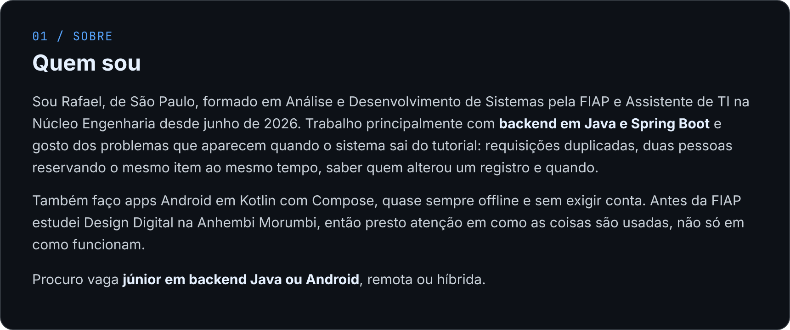

  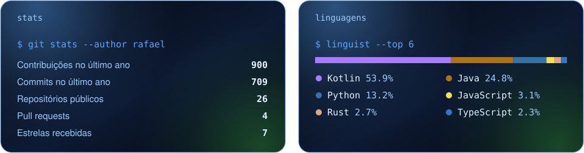

  <a href="https://github.com/Famel-svg/SafePix_Async">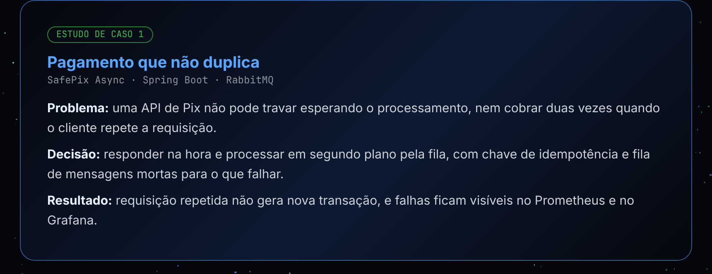</a>

  

  <a href="https://github.com/Famel-svg/estoque-reserva">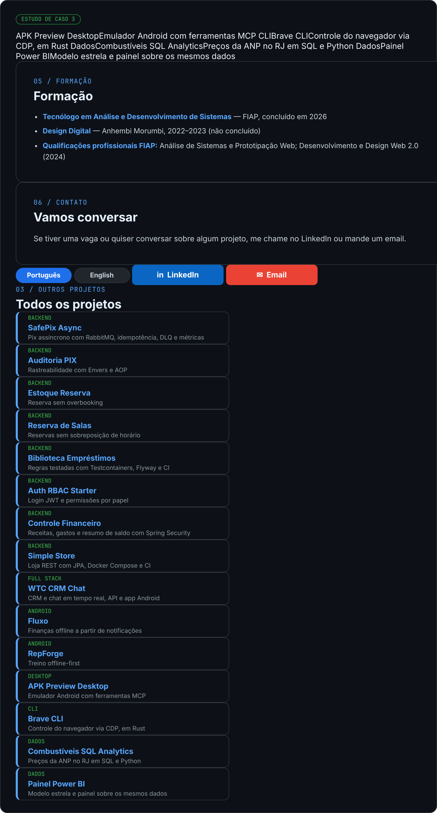</a>

  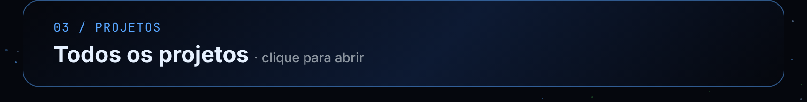

  <a href="https://github.com/Famel-svg/SafePix_Async">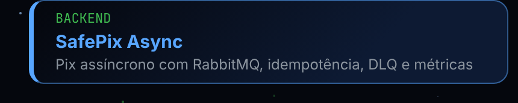</a>
  <a href="https://github.com/Famel-svg/Sistema_Auditoria_PIX">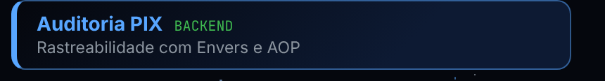</a>

  <a href="https://github.com/Famel-svg/estoque-reserva">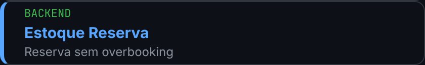</a>
  <a href="https://github.com/Famel-svg/reserva-salas">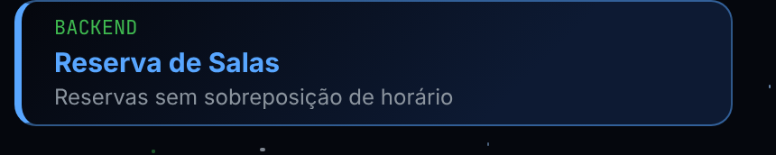</a>

  <a href="https://github.com/Famel-svg/biblioteca-emprestimos">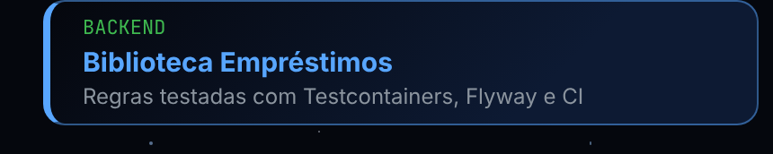</a>
  <a href="https://github.com/Famel-svg/auth-rbac-starter">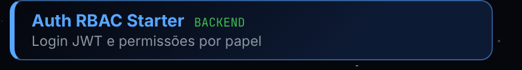</a>

  <a href="https://github.com/Famel-svg/Sistema_De_Controle_Financeiro">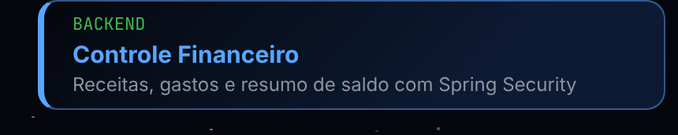</a>
  <a href="https://github.com/Famel-svg/springboot_simple_store">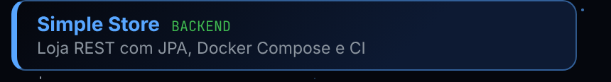</a>

  <a href="https://github.com/Famel-svg/WTC_Chat">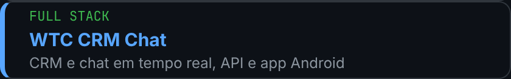</a>
  <a href="https://github.com/Famel-svg/fluxo-android">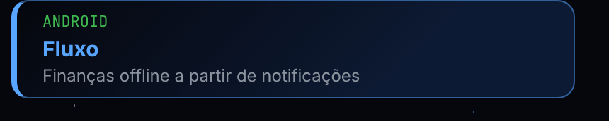</a>

  <a href="https://github.com/Famel-svg/repforge">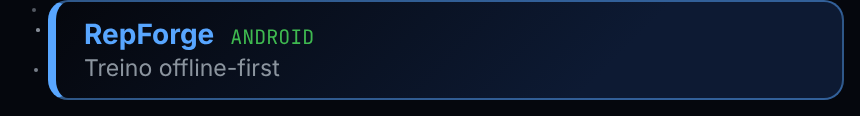</a>
  <a href="https://github.com/Famel-svg/apk-preview-desktop">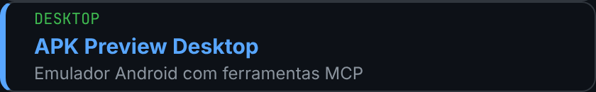</a>

  <a href="https://github.com/Famel-svg/Brave_CLI">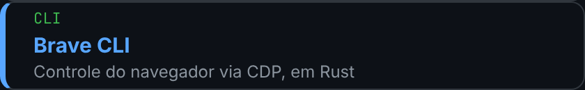</a>
  <a href="https://github.com/Famel-svg/combustiveis-sql-analytics">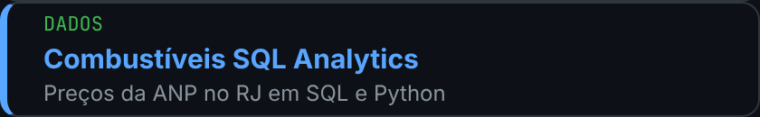</a>

  <a href="https://github.com/Famel-svg/painel-combustiveis-powerbi">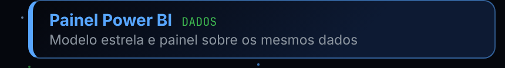</a>

  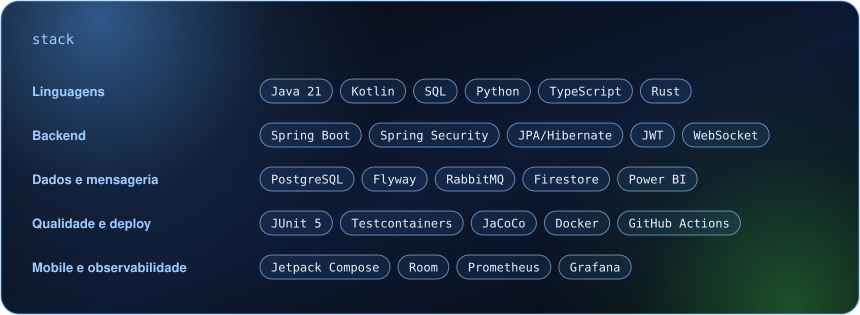

  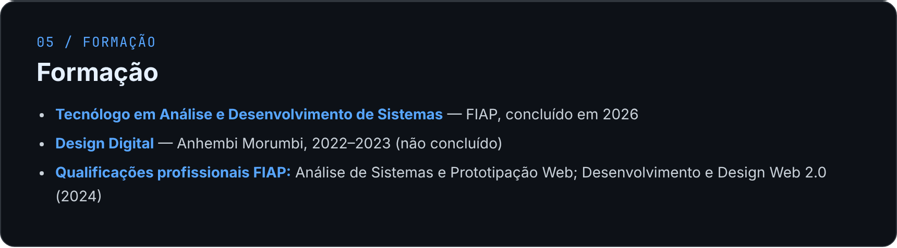

  

  
  &nbsp;&nbsp;
  

