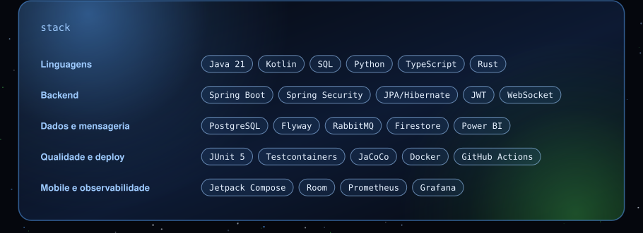

<!-- README em imagens, gerado por scripts/build_readme.py (não edite à mão).
     Cada peça traz sua fatia do fundo animado e fica empilhada sem espaço (align="top"). -->

<b>Versão em texto</b> (mesmo conteúdo das imagens)

## Rafael Tanimoto — Desenvolvedor Backend Java, Spring Boot e Android

São Paulo, Brasil · remoto ou híbrido · inglês fluente · aberto a oportunidades

[LinkedIn](https://www.linkedin.com/in/rafaeltanimoto/) · [Email](mailto:rafaelandradetanimoto@gmail.com)

### 01 / Sobre

Sou Rafael, de São Paulo, formado em Análise e Desenvolvimento de Sistemas pela FIAP e Assistente de TI na Núcleo Engenharia desde junho de 2026. Trabalho principalmente com **backend em Java e Spring Boot** e gosto dos problemas que aparecem quando o sistema sai do tutorial: requisições duplicadas, duas pessoas reservando o mesmo item ao mesmo tempo, saber quem alterou um registro e quando.

Também faço apps Android em Kotlin com Compose, quase sempre offline e sem exigir conta. Antes da FIAP estudei Design Digital na Anhembi Morumbi, então presto atenção em como as coisas são usadas, não só em como funcionam.

Procuro vaga **júnior em backend Java ou Android**, remota ou híbrida.

### 02 / Estudos de caso

#### [Pagamento que não duplica](https://github.com/Famel-svg/SafePix_Async)
*SafePix Async · Spring Boot · RabbitMQ*

**Problema:** uma API de Pix não pode travar esperando o processamento, nem cobrar duas vezes quando o cliente repete a requisição.

**Decisão:** responder na hora e processar em segundo plano pela fila, com chave de idempotência e fila de mensagens mortas para o que falhar.

**Resultado:** requisição repetida não gera nova transação, e falhas ficam visíveis no Prometheus e no Grafana.

#### [Quem mexeu nisso?](https://github.com/Famel-svg/Sistema_Auditoria_PIX)
*Auditoria PIX · Hibernate Envers · AOP*

**Problema:** rastrear cada transação como pede a Resolução BCB nº 1/2020: quem fez, quando, o que mudou e de onde.

**Decisão:** histórico de versões com Envers e captura de origem com AOP, sem espalhar código de auditoria pelas regras de negócio.

**Resultado:** trilha completa por transação e cobertura de testes acima de 80% no JaCoCo.

#### [O último item do estoque](https://github.com/Famel-svg/estoque-reserva)
*Estoque Reserva · Java 21 · PostgreSQL*

**Problema:** dois clientes tentando reservar a última unidade no mesmo instante.

**Decisão:** lock otimista com **@Version**: cada baixa de estoque vira um UPDATE condicionado à versão lida, e quem chega depois recebe 409 Conflict.

**Resultado:** teste com Testcontainers coloca 50 threads disputando 1 unidade, e exatamente uma vence.

### 03 / Projetos

| Projeto | Área | Entrega |
|---|---|---|
| [SafePix Async](https://github.com/Famel-svg/SafePix_Async) | Backend | Pix assíncrono com RabbitMQ, idempotência, DLQ e métricas |
| [Auditoria PIX](https://github.com/Famel-svg/Sistema_Auditoria_PIX) | Backend | Rastreabilidade com Envers e AOP |
| [Estoque Reserva](https://github.com/Famel-svg/estoque-reserva) | Backend | Reserva sem overbooking |
| [Reserva de Salas](https://github.com/Famel-svg/reserva-salas) | Backend | Reservas sem sobreposição de horário |
| [Biblioteca Empréstimos](https://github.com/Famel-svg/biblioteca-emprestimos) | Backend | Regras testadas com Testcontainers, Flyway e CI |
| [Auth RBAC Starter](https://github.com/Famel-svg/auth-rbac-starter) | Backend | Login JWT e permissões por papel |
| [Controle Financeiro](https://github.com/Famel-svg/Sistema_De_Controle_Financeiro) | Backend | Receitas, gastos e resumo de saldo com Spring Security |
| [Simple Store](https://github.com/Famel-svg/springboot_simple_store) | Backend | Loja REST com JPA, Docker Compose e CI |
| [WTC CRM Chat](https://github.com/Famel-svg/WTC_Chat) | Full stack | CRM e chat em tempo real, API e app Android |
| [Fluxo](https://github.com/Famel-svg/fluxo-android) | Android | Finanças offline a partir de notificações |
| [RepForge](https://github.com/Famel-svg/repforge) | Android | Treino offline-first |
| [APK Preview Desktop](https://github.com/Famel-svg/apk-preview-desktop) | Desktop | Emulador Android com ferramentas MCP |
| [Brave CLI](https://github.com/Famel-svg/Brave_CLI) | CLI | Controle do navegador via CDP, em Rust |
| [Combustíveis SQL Analytics](https://github.com/Famel-svg/combustiveis-sql-analytics) | Dados | Preços da ANP no RJ em SQL e Python |
| [Painel Power BI](https://github.com/Famel-svg/painel-combustiveis-powerbi) | Dados | Modelo estrela e painel sobre os mesmos dados |

### 04 / Stack

- **Linguagens:** Java 21, Kotlin, SQL, Python, TypeScript, Rust
- **Backend:** Spring Boot, Spring Security, JPA/Hibernate, JWT, WebSocket
- **Dados e mensageria:** PostgreSQL, Flyway, RabbitMQ, Firestore, Power BI
- **Qualidade e deploy:** JUnit 5, Testcontainers, JaCoCo, Docker, GitHub Actions
- **Mobile e observabilidade:** Jetpack Compose, Room, Prometheus, Grafana

### 05 / Formação

- **Tecnólogo em Análise e Desenvolvimento de Sistemas** — FIAP, concluído em 2026
- **Design Digital** — Anhembi Morumbi, 2022–2023 (não concluído)
- **Qualificações profissionais FIAP:** Análise de Sistemas e Prototipação Web; Desenvolvimento e Design Web 2.0 (2024)

### 06 / Contato

Se tiver uma vaga ou quiser conversar sobre algum projeto, me chame no [LinkedIn](https://www.linkedin.com/in/rafaeltanimoto/) ou mande um [email](mailto:rafaelandradetanimoto@gmail.com).

