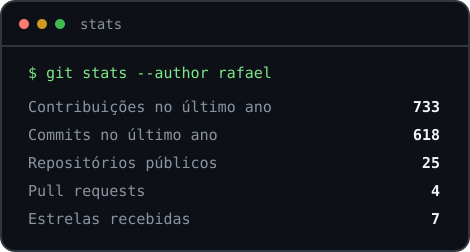
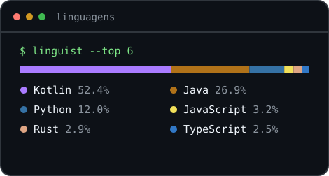

  

  
  
  

  
  

  

## Sobre

Sou Rafael, de São Paulo. Sou formado em Análise e Desenvolvimento de Sistemas pela FIAP e trabalho principalmente com backend em Java e Spring Boot. Gosto de resolver problemas que aparecem quando o sistema sai do tutorial: requisições duplicadas, duas pessoas reservando o mesmo item ao mesmo tempo, saber quem alterou um registro e quando.

Também faço apps Android em Kotlin com Compose, quase sempre offline e sem exigir conta. Antes da FIAP estudei Design Digital na Anhembi Morumbi, então presto atenção em como as coisas são usadas, não só em como funcionam.

Procuro vaga júnior em backend Java ou Android.

  
  

## Projetos

**Backend**

- [WTC CRM Chat](https://github.com/Famel-svg/WTC_Chat) — CRM com chat em tempo real feito para o World Trade Center São Paulo em projeto da FIAP. API Spring Boot com JWT e WebSocket/STOMP, app Android em Compose, Firestore e notificações push via FCM.
- [SafePix Async](https://github.com/Famel-svg/SafePix_Async) — API de Pix que responde na hora e processa em segundo plano com RabbitMQ. Tem idempotência, fila de mensagens mortas e métricas no Prometheus/Grafana.
- [Sistema Auditoria PIX](https://github.com/Famel-svg/Sistema_Auditoria_PIX) — registra quem fez cada transação, quando, o que mudou (Hibernate Envers) e de onde veio (AOP), seguindo a Resolução BCB nº 1/2020. Cobertura de testes acima de 80% no JaCoCo.
- [Estoque Reserva](https://github.com/Famel-svg/estoque-reserva) — reserva de estoque que não vende o mesmo item duas vezes. Java 21 e PostgreSQL.
- [Biblioteca Empréstimos](https://github.com/Famel-svg/biblioteca-emprestimos) — regras de empréstimo cobertas por testes com Testcontainers, migrações Flyway e CI.
- [Auth RBAC Starter](https://github.com/Famel-svg/auth-rbac-starter) — cadastro, login com JWT e permissões por papel no Spring Security.

**Android e desktop**

- [Fluxo](https://github.com/Famel-svg/fluxo-android) — controle financeiro que lê notificações do banco e sugere os lançamentos. Kotlin e Compose.
- [RepForge](https://github.com/Famel-svg/repforge) — app de treino com fichas, plano semanal e histórico. Kotlin, Compose e Room.
- [APK Preview Desktop](https://github.com/Famel-svg/apk-preview-desktop) — app Windows para rodar APKs no emulador, com ferramentas MCP para agentes de IA. Python e PySide6.

**Dados**

- [Combustíveis SQL Analytics](https://github.com/Famel-svg/combustiveis-sql-analytics) e [painel Power BI](https://github.com/Famel-svg/painel-combustiveis-powerbi) — preços da ANP no Rio de Janeiro analisados em SQL e Python.

## Ferramentas

  

## Formação

- Tecnólogo em Análise e Desenvolvimento de Sistemas — FIAP, concluído em 2026
- Design Digital — Anhembi Morumbi, 2022–2023 (não concluído)
- Qualificações profissionais FIAP: Análise de Sistemas e Prototipação Web; Desenvolvimento e Design Web 2.0 (2024)

## Contato

Se tiver uma vaga ou quiser conversar sobre algum projeto, me chame no [LinkedIn](https://www.linkedin.com/in/rafaeltanimoto/) ou mande um [email](mailto:rafaelandradetanimoto@gmail.com).
