<b>Português</b> | <a href="versions/README-en.md">English</a>

  

  
  
  

  
  

  

## 01 / Sobre

Sou Rafael, de São Paulo, formado em Análise e Desenvolvimento de Sistemas pela FIAP. Trabalho principalmente com backend em Java e Spring Boot e gosto dos problemas que aparecem quando o sistema sai do tutorial: requisições duplicadas, duas pessoas reservando o mesmo item ao mesmo tempo, saber quem alterou um registro e quando.

Também faço apps Android em Kotlin com Compose, quase sempre offline e sem exigir conta. Antes da FIAP estudei Design Digital na Anhembi Morumbi, então presto atenção em como as coisas são usadas, não só em como funcionam.

Procuro vaga **júnior em backend Java ou Android**, remota ou híbrida.

  

## 02 / Estudos de caso

<table>
<tr>
<td width="33%" valign="top">

**[Pagamento que não duplica](https://github.com/Famel-svg/SafePix_Async)** 
SafePix Async · Spring Boot · RabbitMQ

**Problema:** uma API de Pix não pode travar esperando o processamento, nem cobrar duas vezes quando o cliente repete a requisição.

**Decisão:** responder na hora e processar em segundo plano pela fila, com chave de idempotência e fila de mensagens mortas para o que falhar.

**Resultado:** requisição repetida não gera nova transação, e falhas ficam visíveis no Prometheus e no Grafana.

</td>
<td width="33%" valign="top">

**[Quem mexeu nisso?](https://github.com/Famel-svg/Sistema_Auditoria_PIX)** 
Auditoria PIX · Hibernate Envers · AOP

**Problema:** rastrear cada transação como pede a Resolução BCB nº 1/2020: quem fez, quando, o que mudou e de onde.

**Decisão:** histórico de versões com Envers e captura de origem com AOP, sem espalhar código de auditoria pelas regras de negócio.

**Resultado:** trilha completa por transação e cobertura de testes acima de 80% no JaCoCo.

</td>
<td width="33%" valign="top">

**[O último item do estoque](https://github.com/Famel-svg/estoque-reserva)** 
Estoque Reserva · Java 21 · PostgreSQL

**Problema:** dois clientes tentando reservar a última unidade no mesmo instante.

**Decisão:** lock otimista com `@Version`: cada baixa de estoque vira um `UPDATE` condicionado à versão lida, e quem chega depois recebe `409 Conflict`.

**Resultado:** teste com Testcontainers coloca 50 threads disputando 1 unidade, e exatamente uma vence.

</td>
</tr>
</table>

## 03 / Outros projetos

- [WTC CRM Chat](https://github.com/Famel-svg/WTC_Chat) — CRM com chat em tempo real feito para o World Trade Center São Paulo em projeto da FIAP. API Spring Boot com JWT e WebSocket/STOMP, app Android em Compose, Firestore e push via FCM.
- [Fluxo](https://github.com/Famel-svg/fluxo-android) — controle financeiro que lê notificações do banco e sugere os lançamentos. Kotlin e Compose.
- [RepForge](https://github.com/Famel-svg/repforge) — app de treino com fichas, plano semanal e histórico. Kotlin, Compose e Room.

<b>Todos os projetos, um a um</b>

| Área | Projeto | Entrega |
|---|---|---|
| Backend | [SafePix Async](https://github.com/Famel-svg/SafePix_Async) | Pix assíncrono com RabbitMQ, idempotência, DLQ e métricas |
| Backend | [Auditoria PIX](https://github.com/Famel-svg/Sistema_Auditoria_PIX) | Rastreabilidade com Envers e AOP |
| Backend | [Estoque Reserva](https://github.com/Famel-svg/estoque-reserva) | Reserva sem overbooking |
| Backend | [Reserva de Salas](https://github.com/Famel-svg/reserva-salas) | Reservas sem sobreposição de horário |
| Backend | [Biblioteca Empréstimos](https://github.com/Famel-svg/biblioteca-emprestimos) | Regras testadas com Testcontainers, Flyway e CI |
| Backend | [Auth RBAC Starter](https://github.com/Famel-svg/auth-rbac-starter) | Login JWT e permissões por papel |
| Backend | [Controle Financeiro](https://github.com/Famel-svg/Sistema_De_Controle_Financeiro) | Receitas, gastos e resumo de saldo com Spring Security |
| Backend | [Simple Store](https://github.com/Famel-svg/springboot_simple_store) | Loja REST com JPA, Docker Compose e CI |
| Full stack | [WTC CRM Chat](https://github.com/Famel-svg/WTC_Chat) | CRM e chat em tempo real, API e app Android |
| Android | [Fluxo](https://github.com/Famel-svg/fluxo-android) | Finanças offline a partir de notificações |
| Android | [RepForge](https://github.com/Famel-svg/repforge) | Treino offline-first |
| Desktop | [APK Preview Desktop](https://github.com/Famel-svg/apk-preview-desktop) | Emulador Android com ferramentas MCP |
| CLI | [Brave CLI](https://github.com/Famel-svg/Brave_CLI) | Controle do navegador via CDP, em Rust |
| Dados | [Combustíveis SQL Analytics](https://github.com/Famel-svg/combustiveis-sql-analytics) | Preços da ANP no RJ em SQL e Python |
| Dados | [Painel Power BI](https://github.com/Famel-svg/painel-combustiveis-powerbi) | Modelo estrela e painel sobre os mesmos dados |

## 04 / Ferramentas

  

## 05 / Formação

- Tecnólogo em Análise e Desenvolvimento de Sistemas — FIAP, concluído em 2026
- Design Digital — Anhembi Morumbi, 2022–2023 (não concluído)
- Qualificações profissionais FIAP: Análise de Sistemas e Prototipação Web; Desenvolvimento e Design Web 2.0 (2024)

## 06 / Contato

Se tiver uma vaga ou quiser conversar sobre algum projeto, me chame no [LinkedIn](https://www.linkedin.com/in/rafaeltanimoto/) ou mande um [email](mailto:rafaelandradetanimoto@gmail.com).
