<!-- README em imagens, gerado por scripts/build_readme.py (não edite à mão).
     Cada peça traz sua fatia do fundo animado e fica empilhada sem espaço (align="top"). -->

<a href="https://github.com/Famel-svg/SafePix_Async"></a><a href="https://github.com/Famel-svg/estoque-reserva"></a><a href="https://github.com/Famel-svg/SafePix_Async"></a><a href="https://github.com/Famel-svg/estoque-reserva"></a><a href="https://github.com/Famel-svg/reserva-salas"></a><a href="https://github.com/Famel-svg/auth-rbac-starter"></a><a href="https://github.com/Famel-svg/springboot_simple_store"></a><a href="https://github.com/Famel-svg/painel-combustiveis-powerbi"></a>

