  

### Backend Java/Spring Boot e Android Kotlin

São Paulo. Formado em ADS pela FIAP, inglês fluente. Faço APIs com testes, Docker, PostgreSQL, RabbitMQ e JWT, e apps Android offline em Compose. Procuro vaga júnior.

Alguns projetos: [WTC CRM Chat](https://github.com/Famel-svg/WTC_Chat), [SafePix Async](https://github.com/Famel-svg/SafePix_Async), [Auditoria PIX](https://github.com/Famel-svg/Sistema_Auditoria_PIX), [Estoque Reserva](https://github.com/Famel-svg/estoque-reserva), [Fluxo](https://github.com/Famel-svg/fluxo-android), [RepForge](https://github.com/Famel-svg/repforge).

[LinkedIn](https://www.linkedin.com/in/rafaeltanimoto/) · [Email](mailto:rafaelandradetanimoto@gmail.com)
