<!-- README em imagens, gerado por scripts/build_readme.py (não edite à mão).
     Cada peça traz sua fatia do fundo animado e fica empilhada sem espaço (align="top"). -->

<b>Text version</b> (same content as the images)

## Rafael Tanimoto — Java Backend, Spring Boot and Android Developer

São Paulo, Brazil · remote or hybrid · fluent English · open to opportunities

[LinkedIn](https://www.linkedin.com/in/rafaeltanimoto/) · [Email](mailto:rafaelandradetanimoto@gmail.com)

### 01 / About

I'm Rafael, from São Paulo, a Systems Analysis and Development graduate from FIAP and an IT Assistant at Núcleo Engenharia since June 2026. I work mostly on **Java and Spring Boot backends**, and I like the problems that show up once a system leaves the tutorial: duplicate requests, two people booking the same item at the same time, knowing who changed a record and when.

I also build Android apps in Kotlin with Compose, usually offline and with no account required. Before FIAP I studied Digital Design at Anhembi Morumbi, so I pay attention to how things are used, not only how they work.

I'm looking for a **junior Java backend or Android role**, remote or hybrid.

### 02 / Case studies

#### [Payments that never double](https://github.com/Famel-svg/SafePix_Async)
*SafePix Async · Spring Boot · RabbitMQ*

**Problem:** a Pix API can't block while processing, or charge twice when the client retries the request.

**Decision:** answer right away and process in the background through a queue, with an idempotency key and a dead-letter queue for failures.

**Result:** a repeated request creates no new transaction, and failures show up in Prometheus and Grafana.

#### [Who touched this?](https://github.com/Famel-svg/Sistema_Auditoria_PIX)
*Pix Audit · Hibernate Envers · AOP*

**Problem:** trace every transaction as Central Bank Resolution 1/2020 requires: who, when, what changed and from where.

**Decision:** version history with Envers and origin capture with AOP, without spreading audit code across business rules.

**Result:** a full trail per transaction and test coverage above 80% in JaCoCo.

#### [The last item in stock](https://github.com/Famel-svg/estoque-reserva)
*Stock Reservation · Java 21 · PostgreSQL*

**Problem:** two customers trying to reserve the last unit at the same moment.

**Decision:** optimistic locking with **@Version**: every stock update is an UPDATE conditioned on the version read, and the loser gets 409 Conflict.

**Result:** a Testcontainers test puts 50 threads against 1 unit, and exactly one wins.

### 03 / Projects

| Project | Area | What it does |
|---|---|---|
| [SafePix Async](https://github.com/Famel-svg/SafePix_Async) | Backend | Async Pix with RabbitMQ, idempotency, DLQ and metrics |
| [Pix Audit](https://github.com/Famel-svg/Sistema_Auditoria_PIX) | Backend | Traceability with Envers and AOP |
| [Stock Reservation](https://github.com/Famel-svg/estoque-reserva) | Backend | Reservations without overbooking |
| [Room Booking](https://github.com/Famel-svg/reserva-salas) | Backend | Bookings without time overlap |
| [Library Loans](https://github.com/Famel-svg/biblioteca-emprestimos) | Backend | Rules tested with Testcontainers, Flyway and CI |
| [Auth RBAC Starter](https://github.com/Famel-svg/auth-rbac-starter) | Backend | JWT login and role-based permissions |
| [Personal Finance API](https://github.com/Famel-svg/Sistema_De_Controle_Financeiro) | Backend | Income, expenses and balance with Spring Security |
| [Simple Store](https://github.com/Famel-svg/springboot_simple_store) | Backend | REST store with JPA, Docker Compose and CI |
| [WTC CRM Chat](https://github.com/Famel-svg/WTC_Chat) | Full stack | CRM and real-time chat, API and Android app |
| [Fluxo](https://github.com/Famel-svg/fluxo-android) | Android | Offline finance from bank notifications |
| [RepForge](https://github.com/Famel-svg/repforge) | Android | Offline-first workout tracker |
| [APK Preview Desktop](https://github.com/Famel-svg/apk-preview-desktop) | Desktop | Android Emulator with MCP tools |
| [Brave CLI](https://github.com/Famel-svg/Brave_CLI) | CLI | Browser control over CDP, in Rust |
| [Fuel SQL Analytics](https://github.com/Famel-svg/combustiveis-sql-analytics) | Data | Rio de Janeiro fuel prices with SQL and Python |
| [Power BI Dashboard](https://github.com/Famel-svg/painel-combustiveis-powerbi) | Data | Star schema and dashboard on the same data |

### 04 / Stack

- **Languages:** Java 21, Kotlin, SQL, Python, TypeScript, Rust
- **Backend:** Spring Boot, Spring Security, JPA/Hibernate, JWT, WebSocket
- **Data and messaging:** PostgreSQL, Flyway, RabbitMQ, Firestore, Power BI
- **Quality and deploy:** JUnit 5, Testcontainers, JaCoCo, Docker, GitHub Actions
- **Mobile and observability:** Jetpack Compose, Room, Prometheus, Grafana

### 05 / Education

- **Technologist degree in Systems Analysis and Development** — FIAP, completed 2026
- **Digital Design** — Anhembi Morumbi, 2022–2023 (not completed)
- **FIAP professional qualifications:** Systems Analysis and Web Prototyping; Web 2.0 Development and Design (2024)

### 06 / Contact

Have a role or want to talk about a project? Reach me on [LinkedIn](https://www.linkedin.com/in/rafaeltanimoto/) or send an [email](mailto:rafaelandradetanimoto@gmail.com).

