  

  <b>Java Backend Developer · Spring Boot · Kotlin/Android</b> 
  🟢 <b>Open to work</b> — internship or junior · remote or hybrid · 📍 Brazil

  
  

## About me

I build **production-minded Java/Spring Boot APIs**: tested business rules, messaging, security and observability. I also ship **native Android apps** in Kotlin/Compose. Systems Analysis & Development student at **FIAP**, with a background in **Digital Design**.

- ✅ Tests (JUnit, Testcontainers) and CI with GitHub Actions
- 🐳 Docker, PostgreSQL, Flyway
- 🔐 Spring Security, JWT, RBAC
- 📨 Async processing with RabbitMQ, idempotency, DLQ
- 📊 Observability with Prometheus and Grafana

## Featured projects

| Project | Problem solved | Stack |
|---|---|---|
| [**SafePix Async**](https://github.com/Famel-svg/SafePix_Async) | Async Pix payment API with idempotency, DLQ and metrics | Spring Boot · RabbitMQ · Grafana |
| [**Pix Audit System**](https://github.com/Famel-svg/Sistema_Auditoria_PIX) | Who/when/what/where audit trail for transactions (Envers + AOP) | Spring Boot · Envers |
| [**Library Loans**](https://github.com/Famel-svg/biblioteca-emprestimos) | Fully tested loan rules, Flyway, Testcontainers, CI | Java 21 · Spring Boot 3.5 |
| [**Stock Reservation**](https://github.com/Famel-svg/estoque-reserva) | Inventory reservation with no overbooking | Java 21 · PostgreSQL |
| [**Fluxo Android**](https://github.com/Famel-svg/fluxo-android) | Offline personal finance: bank notifications become entries | Kotlin · Compose |
| [**RepForge**](https://github.com/Famel-svg/repforge) | Offline-first workout tracker | Kotlin · Compose · Room |
| [**APK Preview Desktop**](https://github.com/Famel-svg/apk-preview-desktop) | Android Emulator control + MCP tools for AI agents | Python · PySide6 |

<i>Hiring for Java backend or Android? <a href="mailto:rafaelandradetanimoto@gmail.com">Reach out</a>.</i>

