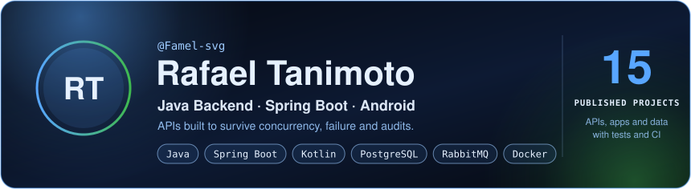
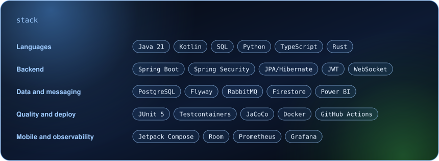

<a href="../README.md">Português</a> | <b>English</b>

  

  
  

  

## 01 / About

I'm Rafael, from São Paulo, with a degree in Systems Analysis and Development from FIAP, working as an IT Assistant at Núcleo Engenharia since June 2026. I mostly work on backend with Java and Spring Boot, and I like the problems that show up after the tutorial ends: duplicate requests, two people booking the same item at once, knowing who changed a record and when.

I also build Android apps in Kotlin and Compose, usually offline and without sign-up. Before FIAP I studied Digital Design, so I care about how things are used, not only how they work. Fluent in English.

Looking for a **junior role in Java backend or Android**, remote or hybrid.

  

## 02 / Case studies

<table>
<tr>
<td width="33%" valign="top">

**[Payments that don't double-charge](https://github.com/Famel-svg/SafePix_Async)** 
SafePix Async · Spring Boot · RabbitMQ

**Problem:** a Pix API can't block while processing, nor charge twice when the client retries.

**Decision:** answer right away and process in the background through a queue, with idempotency keys and a dead-letter queue for failures.

**Result:** a repeated request creates no new transaction, and failures show up in Prometheus and Grafana.

</td>
<td width="33%" valign="top">

**[Who touched this?](https://github.com/Famel-svg/Sistema_Auditoria_PIX)** 
Pix Audit · Hibernate Envers · AOP

**Problem:** trace every transaction as required by Brazilian Central Bank Resolution 1/2020: who, when, what changed and from where.

**Decision:** version history with Envers and origin capture with AOP, keeping audit code out of business rules.

**Result:** full trail per transaction and test coverage above 80% (JaCoCo).

</td>
<td width="33%" valign="top">

**[The last item in stock](https://github.com/Famel-svg/estoque-reserva)** 
Stock Reservation · Java 21 · PostgreSQL

**Problem:** two customers trying to reserve the last unit at the same instant.

**Decision:** optimistic locking with `@Version`: every stock update is an `UPDATE` conditioned on the version read, and the loser gets `409 Conflict`.

**Result:** a Testcontainers test puts 50 threads against 1 unit, and exactly one wins.

</td>
</tr>
</table>

## 03 / Other projects

- [WTC CRM Chat](https://github.com/Famel-svg/WTC_Chat) — CRM with real-time chat built for World Trade Center São Paulo (FIAP project). Spring Boot API with JWT and WebSocket/STOMP, Android app in Compose, Firestore and FCM push.
- [Fluxo](https://github.com/Famel-svg/fluxo-android) — finance app that reads bank notifications and suggests entries. Kotlin, Compose.
- [RepForge](https://github.com/Famel-svg/repforge) — workout tracker with plans and history. Kotlin, Compose, Room.

<b>All projects, one by one</b>

| Area | Project | What it does |
|---|---|---|
| Backend | [SafePix Async](https://github.com/Famel-svg/SafePix_Async) | Async Pix with RabbitMQ, idempotency, DLQ and metrics |
| Backend | [Pix Audit](https://github.com/Famel-svg/Sistema_Auditoria_PIX) | Traceability with Envers and AOP |
| Backend | [Stock Reservation](https://github.com/Famel-svg/estoque-reserva) | Reservations without overbooking |
| Backend | [Room Booking](https://github.com/Famel-svg/reserva-salas) | Bookings without time overlap |
| Backend | [Library Loans](https://github.com/Famel-svg/biblioteca-emprestimos) | Rules tested with Testcontainers, Flyway and CI |
| Backend | [Auth RBAC Starter](https://github.com/Famel-svg/auth-rbac-starter) | JWT login and role-based permissions |
| Backend | [Personal Finance API](https://github.com/Famel-svg/Sistema_De_Controle_Financeiro) | Income, expenses and balance with Spring Security |
| Backend | [Simple Store](https://github.com/Famel-svg/springboot_simple_store) | REST store with JPA, Docker Compose and CI |
| Full stack | [WTC CRM Chat](https://github.com/Famel-svg/WTC_Chat) | CRM and real-time chat, API and Android app |
| Android | [Fluxo](https://github.com/Famel-svg/fluxo-android) | Offline finance from bank notifications |
| Android | [RepForge](https://github.com/Famel-svg/repforge) | Offline-first workout tracker |
| Desktop | [APK Preview Desktop](https://github.com/Famel-svg/apk-preview-desktop) | Android Emulator with MCP tools |
| CLI | [Brave CLI](https://github.com/Famel-svg/Brave_CLI) | Browser control over CDP, in Rust |
| Data | [Fuel SQL Analytics](https://github.com/Famel-svg/combustiveis-sql-analytics) | Fuel prices in Rio de Janeiro with SQL and Python |
| Data | [Power BI dashboard](https://github.com/Famel-svg/painel-combustiveis-powerbi) | Star schema and dashboard on the same data |

## 04 / Stack

## 05 / Education

- Systems Analysis and Development (technologist degree) — FIAP, 2026
- Digital Design — Anhembi Morumbi, 2022–2023 (not completed)

## 06 / Contact

Have a role or want to talk about a project? Reach me on [LinkedIn](https://www.linkedin.com/in/rafaeltanimoto/) or by [email](mailto:rafaelandradetanimoto@gmail.com).
